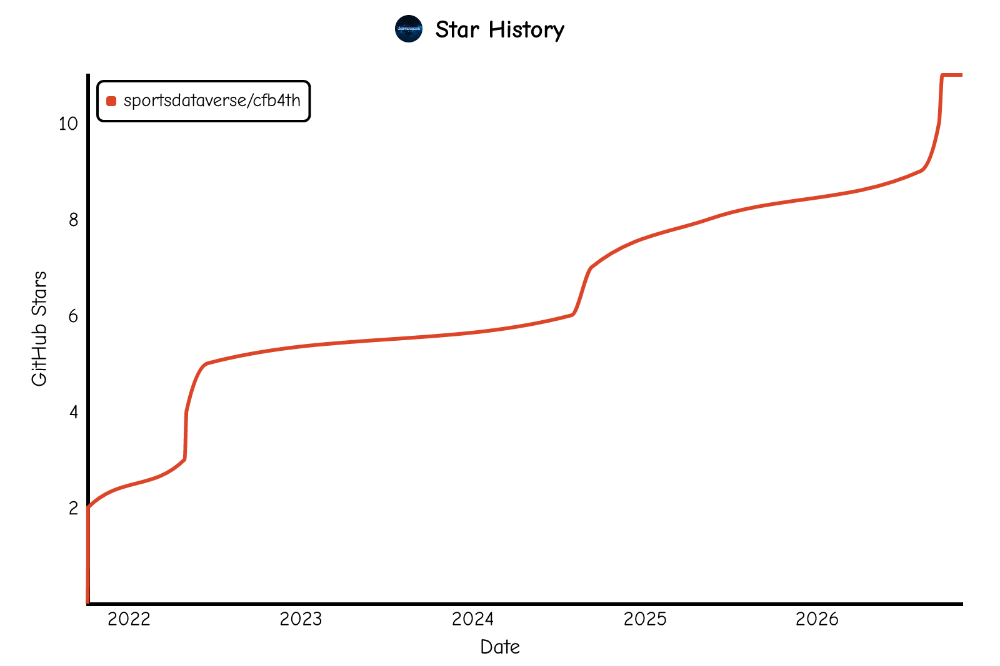

<!-- README.md is generated from README.Rmd. Please edit that file -->

```{r rdmesetup, include = FALSE}
knitr::opts_chunk$set(
  collapse = TRUE,
  comment = "#>",
  fig.path = "man/figures/README-",
  out.width = "100%"
) 
```

# **cfb4th** <a href='https://cfb4th.sportsdataverse.org'></a>

<!-- badges: start -->

[](https://sportsdataverse.r-universe.dev/cfb4th)
[](https://github.com/sportsdataverse/cfb4th/)
[](https://github.com/sportsdataverse/cfb4th/actions/workflows/R-CMD-check.yaml)
[](https://app.codecov.io/gh/sportsdataverse/cfb4th)
[](https://github.com/sportsdataverse/cfb4th/actions/workflows/pkgdown.yaml)
[](https://lifecycle.r-lib.org/articles/stages.html#experimental)
[](https://github.com/sportsdataverse/cfb4th/blob/main/LICENSE.md)
[](https://github.com/sportsdataverse/cfb4th/graphs/contributors)
[](https://github.com/sportsdataverse/cfb4th/stargazers)
[](https://x.com/aisports_4th)
[](https://x.com/SportsDataverse)

<!-- badges: end -->

This is the package that powers the [A.I. Sports College Football 4th Down Model](https://kazink.shinyapps.io/cfb_fourth_down/) discussed in [this UteZone article.](https://247sports.com/college/utah/LongFormArticle/Utah-Fourth-Downs-2020-159851937/) The model is heavily based on the work and [code](https://www.nfl4th.com/) produced by [Ben Baldwin](https://x.com/benbbaldwin) for his [4th Down Calculator for the NFL](https://rbsdm.com/stats/fourth_calculator/)

Data freshness and pipeline status for every SportsDataverse dataset: [sportsdataverse.org/status](https://sportsdataverse.org/status).

## **Installation**

You can install the latest build from [R-universe](https://sportsdataverse.r-universe.dev/cfb4th) with:

```r
install.packages("cfb4th", repos = c("https://sportsdataverse.r-universe.dev", getOption("repos")))
```

You can install the development version of [**`cfb4th`**](https://github.com/sportsdataverse/cfb4th/) from GitHub with:

```r
if (!requireNamespace("pak", quietly = TRUE)) install.packages("pak")
pak::pak("sportsdataverse/cfb4th")
# or: remotes::install_github("sportsdataverse/cfb4th")
```

The two `xgboost` models (fourth-down conversion and win probability) are
not bundled with the package: each is downloaded the first time it is needed
and cached under `tools::R_user_dir("cfb4th", "cache")`, so the first call to
`add_4th_probs()` needs network access. Clear the cache to force a fresh
download with `cfb4th_clear_cache()`.

## **Quick start**

```r
library(cfb4th)

# a season of cfbfastR play-by-play with the fourth-down decision columns added
pbp <- load_4th_pbp(2020)

# the last fourth down of one game from ESPN, scored and laid out as a decision table
game <- data.frame(game_id = 401114223, home_team = "BYU", away_team = "Utah", week = 1)
plays <- get_4th_plays(game)
make_table_data(add_4th_probs(utils::tail(plays, 1)))
```

The [Get Started article](https://cfb4th.sportsdataverse.org/articles/cfb4th.html) walks through both workflows.

## **Features**

* The **go for it** model gives probabilities for possibilities of yards gained and includes the possibility of earning a first down via defensive penalty
* The **punt** model includes the possibility for getting blocked, returned for a touchdown, or fumbled on the return
* The **field goal** model is a simple model of field goal % by distance and roof type

## **Current limitations**

There are some edge cases that are not accounted for. These should only make a marginal difference to the recommendations as they are largely edge cases (e.g. the possibility for a field goal to be blocked and returned).

* The **go for it** model does not allow for the possibility of a turnover return. However, long returns are extremely rare: For example, in 2018 and 2019 in the NFL there were only four defensive touchdowns on plays where teams went for fourth downs out of 1,236 plays, and all of these happened when the game was well in hand for the other team. Additionally, it assumes that a touchdown is worth 7 points and doesn't account for go-for-2 situations (Future Work)
* The **punt** model doesn’t account for the punter or returner, ignores penalties on returns and ignores the potential for blocked punts to be returned for touchdowns
* The **field goal** model doesn’t account for who the kicker is, what the weather is (only relevant for outdoor games), or the possibility of a kick being blocked and returned for a touchdown

## **Get Started**

To get started with cfb4th please see [this article](https://cfb4th.sportsdataverse.org/articles/cfb4th.html). 


* [The logic of the shiny app](https://github.com/Kazink36/cfb_fourth_down/blob/main/app.R)

* [The code that powers the bot](https://github.com/Kazink36/cfb_fourth_down/tree/main/bot)

* [The bot can be found on X here.](https://x.com/aisports_4th)

## **Documentation**

- [Package site](https://cfb4th.sportsdataverse.org/)
- [Function reference](https://cfb4th.sportsdataverse.org/reference/index.html)
- Articles:
  - [Get Started with cfb4th](https://cfb4th.sportsdataverse.org/articles/cfb4th.html)
- [NEWS / changelog](https://cfb4th.sportsdataverse.org/news/index.html)

## **Companion packages**

* [**`cfbfastR`**](https://cfbfastR.sportsdataverse.org/) — the college football play-by-play the `cfb4th` models are fitted on and that `load_4th_pbp()` reads.
* [**`cfbseedR`**](https://cfbseedR.sportsdataverse.org/) — simulate college football seasons, conference standings and the College Football Playoff.
* [**`cfbplotR`**](https://cfbplotR.sportsdataverse.org/) and [**`sdvplotR`**](https://sdvplotR.sportsdataverse.org/) — team logos, colors and `gt` tables for plotting decisions.

## **The SportsDataverse**

[**`cfb4th`**](https://cfb4th.sportsdataverse.org/) is part of the [SportsDataverse](https://sportsdataverse.org/), a set of
open-source packages for sports data.

| Package | Sport / Scope |
|---|---|
| [**cfbfastR**](https://cfbfastR.sportsdataverse.org/) | College football |
| [**hoopR**](https://hoopR.sportsdataverse.org/) | Men's basketball (NBA and NCAA) |
| [**wehoop**](https://wehoop.sportsdataverse.org/) | Women's basketball (WNBA and NCAA) |
| [**fastRhockey**](https://fastRhockey.sportsdataverse.org/) | Hockey (NHL and PWHL) |
| [**baseballr**](https://billpetti.github.io/baseballr/) | Baseball (MLB, MiLB, NCAA) |
| [**softballR**](https://github.com/sportsdataverse/softballR) | College softball |
| [**oddsapiR**](https://oddsapiR.sportsdataverse.org/) | Sports betting odds |
| [**recruitR**](https://recruitR.sportsdataverse.org/) | College football recruiting |
| [**usfootballR**](https://usfootballR.sportsdataverse.org/) | US soccer |
| [**cfbseedR**](https://cfbseedR.sportsdataverse.org/) · [**cfb4th**](https://cfb4th.sportsdataverse.org/) | CFB playoff simulation · fourth-down decisions |
| [**cfbplotR**](https://cfbplotR.sportsdataverse.org/) · [**sdvplotR**](https://sdvplotR.sportsdataverse.org/) · [**sportyR**](https://sportyR.sportsdataverse.org/) | Logos, colors, tables · playing surfaces |
| [**sportsdataverse-R**](https://r.sportsdataverse.org/) | Umbrella R metapackage |
| [**sportsdataverse-py**](https://py.sportsdataverse.org/) · [**sportsdataverse.js**](https://js.sportsdataverse.org/) | Python and Node.js |

See the full ecosystem at [sportsdataverse.org](https://sportsdataverse.org/).

## **Follow the SportsDataverse (@SportsDataverse) on X and star this repo**

[](https://x.com/SportsDataverse)

[](https://github.com/sportsdataverse/cfb4th)

<a href="https://github.com/sportsdataverse/cfb4th">
  <picture>
    <source media="(prefers-color-scheme: dark)" srcset="https://raw.githubusercontent.com/sportsdataverse/cfb4th/star-history/star-history-dark.svg">
    
  </picture>
</a>

## **Our Authors**

-   [Jared Lee](https://github.com/Kazink36) </br>
<a href="https://github.com/Kazink36" target="blank"></a>

-   [Sebastian Carl](https://x.com/mrcaseb)                   
<a href="https://x.com/mrcaseb" target="blank"></a>
<a href="https://github.com/mrcaseb" target="blank"></a>

-   [Ben Baldwin](https://x.com/benbbaldwin)                   
<a href="https://x.com/benbbaldwin" target="blank"></a>
<a href="https://github.com/guga31bb" target="blank"></a>

-   [Saiem Gilani](https://x.com/saiemgilani)
<a href="https://x.com/saiemgilani" target="blank"></a>
<a href="https://github.com/saiemgilani" target="blank"></a>

<!-- cheatsheet-section -->

## **Cheat sheet**

A printable one-page reference for **`cfb4th`**, shared with **`cfbplotR`** and **`cfbseedR`**.

📄 **[Download the cfbplotR / cfb4th / cfbseedR cheat sheet (PDF)](https://sportsdataverse.org/cheatsheets/cfbplotR-cfb4th-cfbseedR.pdf)**

Free to download, print and hand out; light and dark, US Letter landscape.
Every SportsDataverse package has one — browse them all at
**[sportsdataverse.org/cheatsheets](https://sportsdataverse.org/cheatsheets)**.

## **Citations**

To cite the [**`cfb4th`**](https://cfb4th.sportsdataverse.org/) R package in publications, use:

BibTeX Citation
```bibtex
@misc{lee_et_al_2021_cfb4th,
  author = {Jared Lee and Ben Baldwin and Sebastian Carl and Saiem Gilani},
  title = {cfb4th: The SportsDataverse's R Package for College Football 4th Down Modeling.},
  url = {https://cfb4th.sportsdataverse.org/},
  year = {2026}
}
```

## **License**

[**`cfb4th`**](https://cfb4th.sportsdataverse.org/) is released under the [MIT License](https://github.com/sportsdataverse/cfb4th/blob/main/LICENSE.md).
